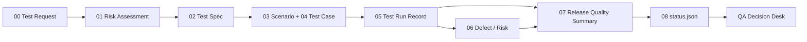

**English** | [繁體中文](README.zh-TW.md)

# QA Decision Desk

QA Decision Desk turns repository, CI, manual-check, and release-review results into a traceable release-decision interface. For each repo it answers first: can we ship now, what is missing, and who has to supply it. Historical decisions and evidence stay in the details and are not treated as the current approval.

[Live Dashboard](https://sanyoii.github.io/test-status/) · [Test Cases and run records](https://sanyoii.github.io/test-status/run-records/) · [Fail and log demo](https://sanyoii.github.io/test-status/run-records/fail-demo/) · [Design samples](https://sanyoii.github.io/test-status/dashboard-demo/) · [Source](https://github.com/sanyoii/RiskQADemoSite)

## Idea

Test results are often scattered across CI logs, manual notes, issues, chat, and personal judgment. QA Decision Desk ties that evidence back to the same release subject, so a reader sees the decision first and can open Gate Flow, Test Case, Run, and Defect only when needed.

The Dashboard is a sanitized, read-only projection. The Release Quality Summary keeps the human judgment. The Run Record keeps what actually ran. The Defect／Risk Log keeps failures and dispositions. `.test-dashboard/status.json` is the machine-readable projection. The screen does not create a second source of truth.

## Active workflow and verification entry points

The full contract, the migration, and the cuts are in [Decision workflow](docs/decision-workflow.md). The main implementation now lives in this repository. The original TestDashboard pilot remains as a historical reference.

- **Three QA-Lite records**: brief/design, an append-only run ledger, and a human-owned decision. The nine templates are still the library.
- **Filled content can be checked**: the Requirement → Risk → Design → Case → Run → Review ID chain, the oracle source hash, the on-file artifact hash, the same subject/environment/config, exception expiry, and the review input digest.
- **Current and historical stay apart**: `npm test` checks the software and historical consistency. `npm run gate:release` checks current release eligibility. Expired evidence does not turn green because someone edits a date.
- **Decision replay / change impact**: the screen replays only recorded history. Synthetic later steps stop before approval. The CLI `review:release --previous` prints a conservative must-run list.
- **Design cuts**: Samples, AC, and ABC moved into design evolution, and the old URLs remain. The home page no longer has effort bars, a fixed Level 2+, or copied approval text.

## Decision flow



Evidence chain for one release:

1. The Test Request locks the repository, release, full SHA, scope, and decision question.
2. The Risk Assessment sets a target coverage for each Product Area.
3. The Test Spec turns risks into automated, manual, exploratory, inspection, or live checks.
4. Scenarios and Test Cases define the user path, the failure path, the data, and the observable result.
5. The Run Record appends every attempt. Fail, Blocked, retry, and a later Pass all stay in the chronology.
6. The Defect Report records the failure, the release impact, the fix, and verification.
7. The Release Quality Summary is where the QA owner, reviewer, and decision owner form the recommendation.
8. The exporter checks the contract, freshness, and public allowlist, then writes the status snapshot.
9. The Dashboard reads the snapshot. A reader can follow links back to public evidence.

## How to read the Dashboard

| Element | Question it answers | Source |
|---|---|---|
| Repository | Which release subject is this? | repo, release／tag, branch, full SHA |
| Objective | Which decision does this run support? | Test Request／Test Spec |
| Release Decision | Can we release now? | human-owned Release Quality Summary |
| Test Effort (details) | How many kinds of test activity were used then? | Run inventory plus QA assessment |
| Coverage | How deep did testing go in each risk area? | Risk Assessment plus Coverage Inventory |
| Quality Assessment | Which warnings, blockers, or residual risks are recorded? | Defect／Risk Log plus QA assessment |
| Historical Gates (details) | What did the original decision record at the time? | G1, G3, G5, G6, and release receipts; not a current authorization |
| Records | Can the judgment be rebuilt? | Test Cases, Run IDs, artifacts, public CI links |

Coverage values `0`, `1`, `1+`, `2`, `2+`, and `3` are test depth, not a code-coverage percentage. `Ready` means the decision owner approved the release conditions. Defects, limits, and residual risk still keep a disposition. `Unreachable` means the latest snapshot could not be fetched, and the product status has to be checked again.

## Historical data examples (not a current release approval)

| Repository | Objective | Decision | Effort | Coverage | Quality | Public evidence |
|---|---|---|---|---|---|---|
| `cex-market-data-quality-lab` | Release Readiness | Historical Ready; rechecked now | High | Level 2+ | Historical assessment | [Test Cases and Run Records](https://sanyoii.github.io/test-status/run-records/) |
| `sanyoii.github.io` | Deployment Confidence | Historical Ready; rechecked now | Medium | Level 2+ | Historical assessment | [Test-gated Pages run](https://github.com/sanyoii/sanyoii.github.io/actions/runs/32241879480) |

Old samples and the original dates remain. On 2026-09-06, owner-reviewed packets were added for a limited automated-portfolio scope: CEX `fc1e060` (40 deterministic + 5 live) and Portfolio `643b017` (22 local Chromium／static checks). William self-reviewed and disclosed the role overlap. That is not an independent review or a formal product certification. The CEX approval expiry is 2026-09-07 20:40, and the Portfolio expiry is 2026-09-13 20:40 (Taiwan time). Whether either is still valid is decided by the gate and the browser time check. An old Pass is not deleted when it expires.

Each card that is not Ready shows one next step taken from the actual cause. [Six synthetic examples](https://sanyoii.github.io/test-status/dashboard-demo/#next-action-examples) use the same rules to show expiry, waiting for approval, an unreachable source, missing evidence and review, No-Go, and At Risk. They do not change real status.

The Fail Demo uses synthetic data to show a Test Case Fail, a demo S1, a new Run for the retest (the original Fail stays), and No-Go. It is not the official result of the two repositories, and it is not a sign-off.

## Core templates and where they go

The nine templates are an authoring library. When you apply them, copy the filled documents into the target repository so the evidence is reviewed with that release version. This public README only indexes the content and the repository locations. The local location of the private QA vault is not published.

| Template | Canonical file | Repository location after use |
|---|---|---|
| [00 QA Test Request](Templates/QA/00-qa-test-request.md) | `Templates/QA/00-qa-test-request.md` | `docs/quality/<release>/quality-decision-brief.md` |
| [01 Quality Risk Assessment](Templates/QA/01-quality-risk-assessment.md) | `Templates/QA/01-quality-risk-assessment.md` | `docs/quality/<release>/risk-assessment.md` |
| [02 Test Spec](Templates/QA/02-test-spec.md) | `Templates/QA/02-test-spec.md` | `docs/quality/<release>/test-spec.md` |
| [03 Test Scenario](Templates/QA/03-test-scenario.md) | `Templates/QA/03-test-scenario.md` | `docs/quality/<release>/coverage-inventory.md` |
| [04 Test Case](Templates/QA/04-test-case.md) | `Templates/QA/04-test-case.md` | `docs/quality/<release>/test-cases.md` |
| [05 Test Run Record](Templates/QA/05-test-run-record.md) | `Templates/QA/05-test-run-record.md` | `test-records/<run-id>/run-record.md` |
| [06 Defect Report](Templates/QA/06-defect-report.md) | `Templates/QA/06-defect-report.md` | `docs/quality/<release>/defect-log.md` |
| [07 Release Quality Summary](Templates/QA/07-release-quality-summary.md) | `Templates/QA/07-release-quality-summary.md` | `docs/quality/<release>/release-quality-summary.md` |
| [08 Dashboard Status Contract](Templates/QA/08-dashboard-status-contract.md) | `Templates/QA/08-dashboard-status-contract.md` | `.test-dashboard/status.json` |

Nine templates do not mean every release produces nine documents. `QA-Lite` can keep the request, risk, coverage, and decision in one short document. The Test Run Record and the Release Quality Summary are kept for every execution. `QA-Standard`, `QA-High-Risk`, and any scope that hits a hard trigger add detailed cases or conditional templates.

### 00 QA Test Request

Locks the requester, release subject, business objective, scope, known risks, limits, and the release question this work supports. If information is missing, the state stays `needs-information`.

### 01 Quality Risk Assessment

Lists each Product Area, failure mode, impact, uncertainty, recoverability, existing controls, target coverage, residual risk, and owner. Unknown is not treated as Low by default.

### 02 Test Spec

Defines the tested scope, test types, entry／suspension／exit criteria, environment, test data, execution method, artifacts, retention, review, and limitations.

### 03 Test Scenario

Describes the start state, trigger, happy／negative paths, expected outcome, and risk traceability as a user or business path. It does not hold click-by-click steps.

### 04 Test Case

Keeps preconditions, concrete data, ordered steps, the observable expected result, cleanup, and variants. Case priority is execution priority. The actual result is written in the Run Record.

### 05 Test Run Record

Append-only record of the full SHA, worktree, environment, exact command／procedure, every attempt, exit code, case results, artifact hash, retention, and final run state. The final run state is only Not Run, Skipped (with a reason), Blocked, Pass, or Fail. A retest is a new Run.

### 06 Defect Report

Connects a failure to the requirement, risk, scenario, case, and run. It separates suspected cause, confirmed cause, Fixed, and Verified.

### 07 Release Quality Summary

Collects coverage target／actual, the run inventory, open defects, accepted risks, waivers, limitations, and the recommendation. The decision owner then records Go, No-Go, or Hold.

### 08 Dashboard Status Contract

Constrains versions, subject, assessment, timestamps, Data Status, evidence links, and public disclosure in `.test-dashboard/status.json`. An invalid schema, stale evidence, or an authority mismatch fails closed.

## QA Playbooks

[QA Playbooks](Playbooks/QA/README.md) are an advisory layer between the input data and the nine core templates. They turn a requirement, API contract, diff, test inventory, or defect into a reviewable draft. They do not themselves produce a test result, a release decision, or a Dashboard status.

| Playbook | Use | Where the reviewed output lands |
|---|---|---|
| [Requirement Readiness](Playbooks/QA/requirement-readiness.md) | Find gaps and contradictions in requirements／acceptance criteria | 00, 01 |
| [Coverage Analysis](Playbooks/QA/coverage-analysis.md) | Build requirement-to-run traceability | `coverage-inventory.md` after 03 is applied; 07 cites the summary only |
| [Regression Selection](Playbooks/QA/regression-selection.md) | Propose Must-run／Should-run／Skip-with-reason | 02, 05 |
| [Test Data Design](Playbooks/QA/test-data-design.md) | Design safe valid／invalid／boundary／synthetic data | conditional Test Data Sheet, 04 |
| [API Coverage Design](Playbooks/QA/api-coverage-design.md) | Design API coverage from the contract | 02, 03, 04 |
| [Defect Triage](Playbooks/QA/defect-triage.md) | Propose duplicate／priority／owner recommendations in a batch | triage note across several 06 reports |
| [RCA／Escape Analysis](Playbooks/QA/rca-escape-analysis.md) | Separate symptom, hypothesis, confirmed cause, and escape point | 06 appendix／RCA evidence |

Playbook output is marked draft／recommendation first. External input is untrusted data. Without a run receipt, do not claim Pass. Without a human-owned Release Quality Summary, do not claim Ready. Deterministic fixtures check the contract only. They are not a model-behavior PASS. The pilot record is [test-records/playbook-pilot.md](test-records/playbook-pilot.md).

## Source of truth and public boundary

| Layer | What it stores | Rule |
|---|---|---|
| QA template library | Reusable blank templates | Defines fields and flow only. It does not mean the work was executed. |
| Repository evidence | Release-specific docs, run records, machine results, artifacts | Bound to the full SHA, environment, scope, and chronology |
| Status contract | Machine-readable projection of an approved assessment | The validator does not guess missing values. On failure it keeps last-known-good and marks Stale／Invalid／Unreachable. |
| Public Dashboard | Sanitized snapshot needed to support the decision | Shows allowlist fields and public links only |

The public surface does not include raw logs, protected receipts, credentials, test accounts, PII, local paths, private URLs, sensitive test data, or unsanitized defect details.

## Repository map

- [Official Dashboard](app/page.tsx)
- [Nine core QA templates](Templates/QA/README.md)
- [Status contract schema](schema/test-status.schema.json)
- [Approved source records](data/approved)
- [Public snapshot registry](data/repos/index.json)
- [Repository data adapter](app/dashboard-data.ts)
- [Current decision / historical evidence UI](app/_dashboard.tsx)
- [Shared decision policy](lib/decision-policy.mjs)
- [Filled release evidence validator](lib/release-evidence.mjs)
- [Test Cases and Run Records](app/run-records/page.tsx)
- [Synthetic Fail Demo](app/run-records/fail-demo/page.tsx)
- [Contract, sync, and registry tests](tests/status-contract.test.mjs)
- [Rendered route tests](tests/rendered-html.test.mjs)
- [Pages artifact check](docs/reviewed-pages-artifact.md)

## Local development

Requires Node.js `>=22.13.0`.

```bash
npm ci
npm run dev
npm test
npm run lint
```

`npm test` checks the archive registry, contract, chronology, public disclosure boundary, and playbooks, then builds and checks every route. It does not declare current evidence freshness or release approval.

`npm run verify:workflow` also records lint, typecheck, the Pages build/export, and the release gate. Each run writes new actual logs, SHA-256 values, and the source/worktree digest. Raw artifacts stay in an ignored local folder and are not packaged into the public UI. The `release-gate` result is stored on its own. A software Pass does not hide a product release Fail.

The static export is for `test-status/` on `sanyoii.github.io`. This repo does not upload it.

```bash
GITHUB_PAGES=true npm run build
node scripts/prepare-pages-artifact.mjs --source dist/client --output out/test-status-preview
```

`out/test-status-preview` must be a new directory. Review the output yourself. Do not treat this command as a completed publication.
