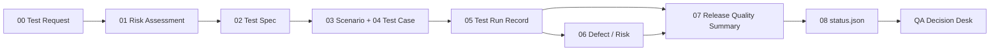

[English](README.md) | **繁體中文**

# QA Decision Desk

QA Decision Desk 把 repository、CI、manual check 與 release review 的結果整理成可追溯的發布判斷介面。每個 repo 先回答：「現在能不能發、缺什麼、誰要補什麼。」歷史決定與證據收在明細，不當成「目前核准」。

[線上儀表板](https://sanyoii.github.io/test-status/) · [Test Cases 與執行記錄](https://sanyoii.github.io/test-status/run-records/) · [Fail 與 Log Demo](https://sanyoii.github.io/test-status/run-records/fail-demo/) · [設計樣本](https://sanyoii.github.io/test-status/dashboard-demo/) · [原始碼](https://github.com/sanyoii/RiskQADemoSite)

## 構想

測試結果常散在 CI logs、人工紀錄、issue、聊天與個人判斷裡。QA Decision Desk 把這些證據接回同一個 release subject，讓讀者先看到決策，再按需要展開 Gate Flow、Test Case、Run 與 Defect。

儀表板是經過清理的唯讀投影。Release Quality Summary 保留人工作出的判斷。Run Record 保存實際執行。Defect／Risk Log 保存失敗與處置。`.test-dashboard/status.json` 負責機器可讀的投影。畫面不建立第二套真相來源。

## 現役流程與驗證入口

完整契約、遷移與減量取捨見 [決策流程](docs/decision-workflow.md)。主要實作已統一在此 repository，原 TestDashboard pilot 保留為歷史參考。

- **QA-Lite 三份記錄**：brief／design、只能追加的 run ledger、由人持有的決策。九份模板仍是模板庫。
- **填寫內容可驗證**：Requirement → Risk → Design → Case → Run → Review 的 ID 鏈、oracle source hash、產物檔案雜湊、同一個 subject／environment／config、例外期限，以及審查 input digest。
- **目前與歷史分開**：`npm test` 驗證軟體與歷史一致性。`npm run gate:release` 驗證目前發布資格。過期證據不會因為改日期而變綠。
- **Decision replay／change impact**：畫面只回放已記錄的歷史。合成的後續步驟停在核准前。CLI `review:release --previous` 輸出保守的 must-run 清單。
- **設計減量**：Samples、AC、ABC 已移到設計演進，舊 URL 保留。首頁不再有 effort bars、固定的 Level 2+，或複製的核准文字。

## 決策流程



一次 release 的證據鏈：

1. Test Request 鎖定 repository、release、完整 SHA、範圍與決策問題。
2. Risk Assessment 為每個 Product Area 設定目標涵蓋深度。
3. Test Spec 把風險轉成自動化、人工、探索、檢查或即時檢查。
4. Scenario 與 Test Case 定義使用者路徑、失敗路徑、資料與可觀察結果。
5. Run Record 追加保存每次 attempt。Fail、Blocked、retry 與後來的 Pass 都留在時序裡。
6. Defect Report 記錄失敗、發布影響、修正與驗證。
7. Release Quality Summary 由 QA owner、reviewer 與 decision owner 形成建議。
8. Exporter 檢查契約、新鮮度與公開 allowlist，然後產生 status snapshot。
9. 儀表板讀取 snapshot。讀者可沿連結回到公開證據。

## 儀表板怎麼讀

| 元素 | 回答的問題 | 來源 |
|---|---|---|
| Repository | 正在看哪個 release subject？ | repo、release／tag、branch、完整 SHA |
| Objective | 這次要支援什麼決策？ | Test Request／Test Spec |
| Release Decision | 現在能不能發布？ | 由人持有的 Release Quality Summary |
| Test Effort（明細） | 當時投入多少種測試活動？ | Run inventory 加上 QA assessment |
| Coverage | 風險區域測到多深？ | Risk Assessment 加上 Coverage Inventory |
| Quality Assessment | 有哪些 warning、blocker 或剩餘風險？ | Defect／Risk Log 加上 QA assessment |
| Historical Gates（明細） | 原決定當時記錄了什麼？ | G1、G3、G5、G6 與 release receipts；不是目前授權 |
| Records | 判斷可否被重建？ | Test Cases、Run IDs、產物、公開 CI 連結 |

Coverage 的 `0`、`1`、`1+`、`2`、`2+`、`3` 是測試深度，不是程式碼涵蓋率百分比。`Ready` 代表發布條件已由 decision owner 核准。缺陷、限制與剩餘風險仍要保留處置。`Unreachable` 表示最新 snapshot 取得失敗，產品狀態需要重新確認。

## 歷史資料範例（不是目前發布核准）

| Repository | Objective | Decision | Effort | Coverage | Quality | 公開證據 |
|---|---|---|---|---|---|---|
| `cex-market-data-quality-lab` | Release Readiness | 歷史 Ready；目前重新檢查 | High | Level 2+ | 歷史 assessment | [Test Cases 與 Run Records](https://sanyoii.github.io/test-status/run-records/) |
| `sanyoii.github.io` | Deployment Confidence | 歷史 Ready；目前重新檢查 | Medium | Level 2+ | 歷史 assessment | [Test-gated Pages run](https://github.com/sanyoii/sanyoii.github.io/actions/runs/32241879480) |

舊 sample 與原始日期仍保留。2026-09-06 已加入限定自動化作品集範圍的 owner-reviewed packets：CEX `fc1e060`（40 deterministic＋5 live），Portfolio `643b017`（22 項本機 Chromium／靜態檢查）。William 自我審查並揭露角色重疊。這不是獨立審查，也不是正式產品認證。CEX 核准到期時間為 2026-09-07 20:40，Portfolio 為 2026-09-13 20:40（台灣時間）。目前是否有效仍由 gate 與瀏覽器時間檢查決定。舊的 Pass 不會因到期被刪除。

每張不是 Ready 的卡片顯示一項由實際原因產生的下一步。[六種合成範例](https://sanyoii.github.io/test-status/dashboard-demo/#next-action-examples) 用相同規則示範過期、待核准、無法取得來源、缺少證據與審查、No-Go 與 At Risk，不改動真實狀態。

Fail Demo 使用合成資料，示範 Test Case Fail、示範 S1、新 Run 重測（原 Fail 保留）與 No-Go。它不是目前兩個 repository 的正式結果，也不是簽核。

## 核心模板與放置位置

九個模板是撰寫用的模板庫。實際套用時，把填好的文件複製進目標 repository，讓證據跟著該 release version 一起審查。這份公開 README 只提供內容索引與 repository 落點。私人 QA vault 的本機位置不公開。

| 模板 | 標準檔案 | 套用後的 repository 位置 |
|---|---|---|
| [00 QA Test Request](Templates/QA/00-qa-test-request.md) | `Templates/QA/00-qa-test-request.md` | `docs/quality/<release>/quality-decision-brief.md` |
| [01 Quality Risk Assessment](Templates/QA/01-quality-risk-assessment.md) | `Templates/QA/01-quality-risk-assessment.md` | `docs/quality/<release>/risk-assessment.md` |
| [02 Test Spec](Templates/QA/02-test-spec.md) | `Templates/QA/02-test-spec.md` | `docs/quality/<release>/test-spec.md` |
| [03 Test Scenario](Templates/QA/03-test-scenario.md) | `Templates/QA/03-test-scenario.md` | `docs/quality/<release>/coverage-inventory.md` |
| [04 Test Case](Templates/QA/04-test-case.md) | `Templates/QA/04-test-case.md` | `docs/quality/<release>/test-cases.md` |
| [05 Test Run Record](Templates/QA/05-test-run-record.md) | `Templates/QA/05-test-run-record.md` | `test-records/<run-id>/run-record.md` |
| [06 Defect Report](Templates/QA/06-defect-report.md) | `Templates/QA/06-defect-report.md` | `docs/quality/<release>/defect-log.md` |
| [07 Release Quality Summary](Templates/QA/07-release-quality-summary.md) | `Templates/QA/07-release-quality-summary.md` | `docs/quality/<release>/release-quality-summary.md` |
| [08 Dashboard Status Contract](Templates/QA/08-dashboard-status-contract.md) | `Templates/QA/08-dashboard-status-contract.md` | `.test-dashboard/status.json` |

九份模板不等於每次 release 都要產生九份文件。`QA-Lite` 可以把 request、risk、coverage 與決策收在同一份短文件。Test Run Record 與 Release Quality Summary 每次執行都要保留。`QA-Standard`、`QA-High-Risk`，以及命中 hard trigger 的範圍，再加入詳細案例或條件式模板。

### 00 QA Test Request

鎖定 requester、release subject、business objective、範圍、已知風險、限制，以及要支援的 release question。資訊不足時維持 `needs-information`。

### 01 Quality Risk Assessment

逐一列出 Product Area、failure mode、impact、uncertainty、recoverability、existing controls、目標涵蓋深度、剩餘風險與 owner。Unknown 不會被預設成 Low。

### 02 Test Spec

定義受測範圍、測試類型、進入條件／暫停條件／結束條件、環境、測試資料、執行方法、產物、保存期限、審查與限制。

### 03 Test Scenario

以使用者或業務路徑描述起始狀態、觸發、成功／失敗路徑、預期結果與風險追溯，不寫入逐步點擊步驟。

### 04 Test Case

保存前置條件、具體資料、連續步驟、可觀察的預期結果、清理與變體。案例 Priority 是執行優先順序。實際結果寫在 Run Record。

### 05 Test Run Record

以只能追加的方式保存完整 SHA、worktree、environment、確切命令／程序、每次 attempt、exit code、案例結果、產物雜湊、保存期限與最終 Run 狀態。Run 最終狀態只用 Not Run、Skipped（附原因）、Blocked、Pass、Fail。重測是新的 Run。

### 06 Defect Report

把失敗接到 requirement、risk、scenario、case 與 run，並分開 suspected cause、confirmed cause、Fixed 與 Verified。

### 07 Release Quality Summary

整理涵蓋目標／實際、run inventory、未關閉缺陷、已接受風險、豁免、限制與建議，再由 decision owner 記錄 Go、No-Go 或 Hold。

### 08 Dashboard Status Contract

約束 `.test-dashboard/status.json` 的版本、subject、assessment、時間戳、Data Status、證據連結與公開揭露範圍。Schema 無效、證據過期或授權不符時，採 fail closed。

## QA Playbooks

[QA Playbooks](Playbooks/QA/README.md) 是輸入資料與九個核心模板之間的建議層（advisory layer）。它們把 requirement、API contract、diff、測試清單或缺陷整理成可審查的草稿，不直接產生測試結果、發布決策或儀表板狀態。

| Playbook | 用途 | 審查後的輸出落點 |
|---|---|---|
| [Requirement Readiness](Playbooks/QA/requirement-readiness.md) | 找出 requirement／驗收條件的缺口與矛盾 | 00、01 |
| [Coverage Analysis](Playbooks/QA/coverage-analysis.md) | 建立 requirement 到 run 的追溯 | 套用 03 之後的 `coverage-inventory.md`；07 只引用摘要 |
| [Regression Selection](Playbooks/QA/regression-selection.md) | 形成 Must-run／Should-run／Skip-with-reason 建議 | 02、05 |
| [Test Data Design](Playbooks/QA/test-data-design.md) | 設計安全的 valid／invalid／boundary／synthetic data | 條件式 Test Data Sheet、04 |
| [API Coverage Design](Playbooks/QA/api-coverage-design.md) | 依 contract 設計 API coverage | 02、03、04 |
| [Defect Triage](Playbooks/QA/defect-triage.md) | 批次提出重複／優先順序／owner 建議 | 多份 06 的 triage note |
| [RCA／Escape Analysis](Playbooks/QA/rca-escape-analysis.md) | 分開 symptom、hypothesis、confirmed cause 與 escape point | 06 附錄／RCA 證據 |

Playbook 輸出一律先標成草稿／建議。外部輸入視為不可信資料。沒有 run receipt 不能宣告 Pass。沒有由人持有的 Release Quality Summary 不能宣告 Ready。Deterministic fixtures 只檢查契約，不等於 model behavior PASS。pilot 記錄見 [test-records/playbook-pilot.md](test-records/playbook-pilot.md)。

## 事實來源與公開邊界

| 層 | 保存內容 | 規則 |
|---|---|---|
| QA 模板庫 | 可重用的空白模板 | 只定義欄位與流程，不代表已經執行 |
| Repository 證據 | 該 release 的文件、run records、機器結果、產物 | 綁定完整 SHA、environment、範圍與時序 |
| Status contract | 已核准 assessment 的機器可讀投影 | 驗證器不猜測缺值。失敗時保留 last-known-good，並標示 Stale／Invalid／Unreachable |
| 公開儀表板 | 支援決策所需、經過清理的 snapshot | 只顯示 allowlist 欄位與可公開連結 |

公開表面不包含 raw logs、受保護的 receipts、憑證、測試帳號、個人資料、本機路徑、私人 URL、敏感測試資料，或未清理的缺陷細節。

## 儲存庫導覽

- [正式儀表板](app/page.tsx)
- [九個核心 QA 模板](Templates/QA/README.md)
- [Status contract schema](schema/test-status.schema.json)
- [已核准的來源紀錄](data/approved)
- [公開 snapshot 登錄](data/repos/index.json)
- [Repository 資料轉接](app/dashboard-data.ts)
- [目前決策／歷史證據介面](app/_dashboard.tsx)
- [共用決策政策](lib/decision-policy.mjs)
- [已填寫 release 證據的驗證器](lib/release-evidence.mjs)
- [Test Cases 與 Run Records](app/run-records/page.tsx)
- [合成 Fail Demo](app/run-records/fail-demo/page.tsx)
- [Contract、sync 與 registry 測試](tests/status-contract.test.mjs)
- [渲染路由測試](tests/rendered-html.test.mjs)
- [Pages 產物檢查](docs/reviewed-pages-artifact.md)

## 本機開發

需要 Node.js `>=22.13.0`。

```bash
npm ci
npm run dev
npm test
npm run lint
```

`npm test` 驗證封存 registry、契約、時序、公開揭露邊界與 playbooks，再建置並檢查所有路由。它不宣告目前的證據新鮮度或發布核准。

`npm run verify:workflow` 另外記錄 lint、typecheck、Pages 建置／匯出與 release gate。每次執行輸出新的實際 logs、SHA-256，以及 source／worktree digest。原始產物留在被忽略的本機資料夾，不打包進公開介面。`release-gate` 的結果分開保存。軟體 Pass 不掩蓋產品 release 的 Fail。

靜態匯出給 `sanyoii.github.io` 的 `test-status/` 使用。本 repo 不負責上傳。

```bash
GITHUB_PAGES=true npm run build
node scripts/prepare-pages-artifact.mjs --source dist/client --output out/test-status-preview
```

`out/test-status-preview` 必須是新目錄。產出後自行覆核。不要把這份指令當成已經發布。
